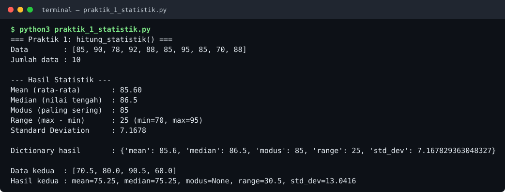
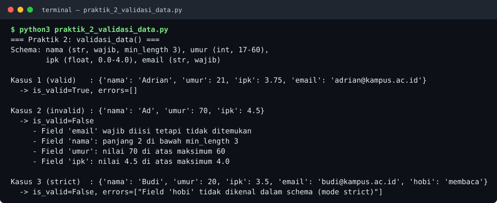
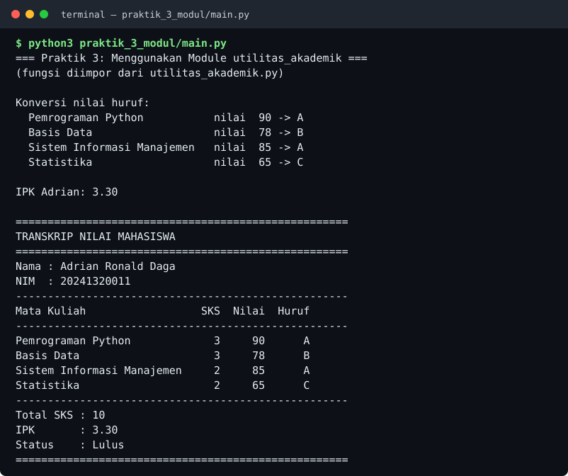
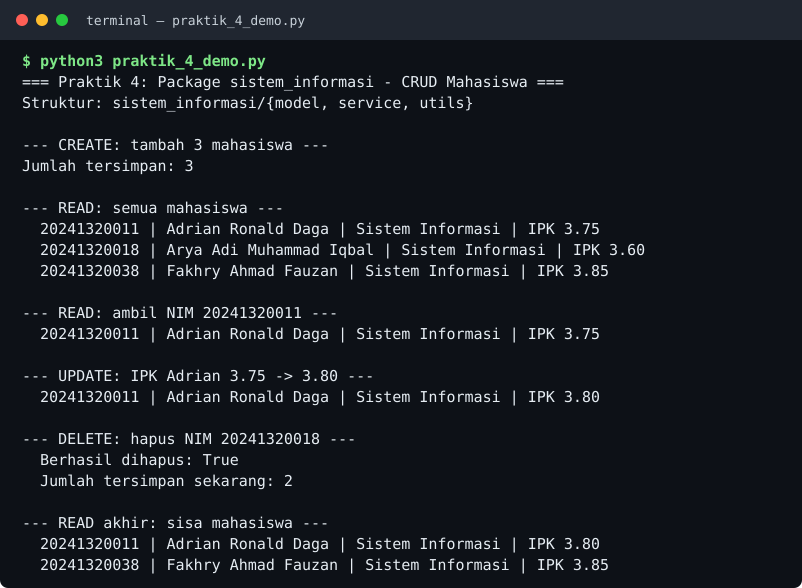
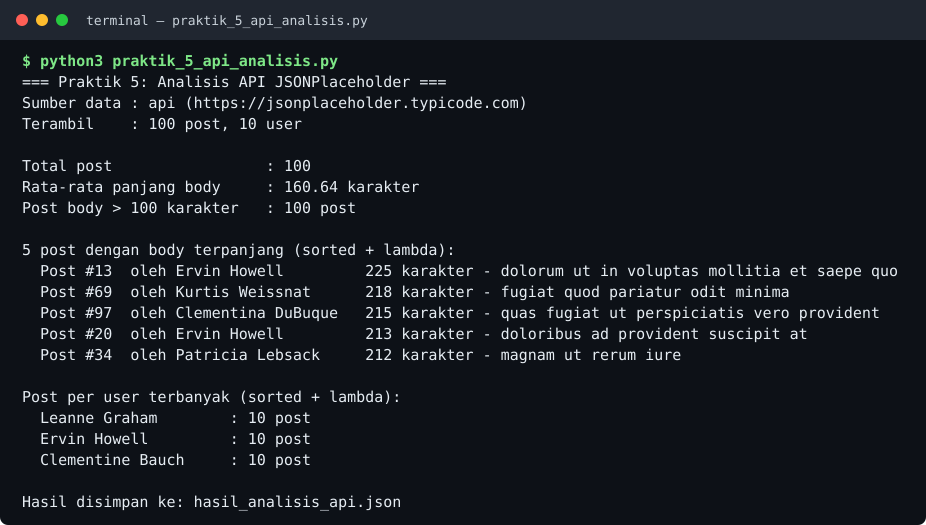

# Practice Python 6 — Latihan Function, Module, Package & Library

Latihan soal dari **Modul Pemrograman Python (Pertemuan 6): Function, Parameter, Return Value, Scope, Lambda, Module, Package & Library** — Program Studi Sistem Informasi.

Nama: **Adrian Ronald Daga** · NPM: **20241320011** · GitHub: [@byedriand](https://github.com/byedriand)

## Isi Repository

| File / Folder | Keterangan |
|---|---|
| `Jawaban_Latihan_Function_Module_Package.md` | Jawaban lengkap **Soal Teori (5 soal)** dan ringkasan Soal Praktik beserta contoh output |
| `praktik_1_statistik.py` | Praktik 1 — fungsi `hitung_statistik()` (mean, median, modus, range, std dev) |
| `praktik_2_validasi_data.py` | Praktik 2 — fungsi `validasi_data()` dengan schema, `*args` & `**kwargs` |
| `praktik_3_modul/utilitas_akademik.py` | Praktik 3 — module: `hitung_ipk()`, `konversi_nilai_huruf()`, `generate_transkrip()` |
| `praktik_3_modul/main.py` | Praktik 3 — file utama yang mengimpor & menggunakan module di atas |
| `sistem_informasi/` | Praktik 4 — package dengan subpackage `model`, `service`, `utils` (masing-masing ada `__init__.py` + modul) |
| `praktik_4_demo.py` | Praktik 4 — demo CRUD Mahasiswa (dictionary in-memory) dari package `sistem_informasi` |
| `praktik_5_api_analisis.py` | Praktik 5 — ambil data API JSONPlaceholder dengan `requests`, proses dengan lambda + `map`/`filter`/`sorted` |
| `hasil_analisis_api.json` | Hasil analisis Praktik 5 yang disimpan dengan modul `json` |
| `output/` | Foto bukti hasil output setiap program |

### Struktur Package Praktik 4

```text
sistem_informasi/
├── __init__.py
├── model/
│   ├── __init__.py
│   └── mahasiswa.py
├── service/
│   ├── __init__.py
│   └── mahasiswa_service.py
└── utils/
    ├── __init__.py
    └── validator.py
```

## Cara Menjalankan

```bash
python3 praktik_1_statistik.py
python3 praktik_2_validasi_data.py
python3 praktik_3_modul/main.py
python3 praktik_3_modul/utilitas_akademik.py   # mode testing module
python3 praktik_4_demo.py
pip install requests
python3 praktik_5_api_analisis.py
```

---

## Bukti Output Program

### Praktik 1 — Fungsi `hitung_statistik()`
Mengembalikan dictionary berisi mean, median, modus, range, dan standard deviation, hanya dengan standard library (`statistics`, `math`). Untuk data `[85, 90, 78, 92, 88, 85, 95, 85, 70, 88]`: mean **85,60**, median **86,5**, modus **85**, range **25**, std dev **7,1678**.



### Praktik 2 — Fungsi `validasi_data()`
Memvalidasi dictionary terhadap schema (tipe & rentang), mengembalikan tuple `(is_valid, errors)`. Field wajib tambahan lewat `*args`, opsi `strict=True` lewat `**kwargs`. Kasus invalid terdeteksi 4 error: email wajib hilang, nama terlalu pendek, umur & IPK di atas maksimum.



### Praktik 3 — Module `utilitas_akademik.py` + `main.py`
`main.py` mengimpor `hitung_ipk()`, `konversi_nilai_huruf()`, dan `generate_transkrip()` dari module terpisah. Konversi: 90→A, 78→B, 85→A, 65→C, dengan IPK **3,30** (10 SKS) dan transkrip berstatus Lulus. Kedua file dilengkapi `if __name__ == "__main__":` untuk testing.



### Praktik 4 — Package `sistem_informasi` (CRUD Mahasiswa)
Package berisi subpackage `model`, `service`, dan `utils`. CRUD memakai dictionary in-memory dengan NIM sebagai kunci: CREATE 3 mahasiswa → UPDATE IPK Adrian 3,75 → 3,80 → DELETE 1 mahasiswa → sisa **2** mahasiswa.



### Praktik 5 — API JSONPlaceholder + Lambda & Higher-Order Function
Mengambil data live dari `https://jsonplaceholder.typicode.com` dengan library `requests` (**100 post, 10 user**), lalu memprosesnya dengan lambda + `map`/`filter`/`sorted`: rata-rata panjang body **160,64** karakter, post terpanjang #13 oleh Ervin Howell (225 karakter). Hasil lengkap disimpan ke `hasil_analisis_api.json` dengan modul `json`.


